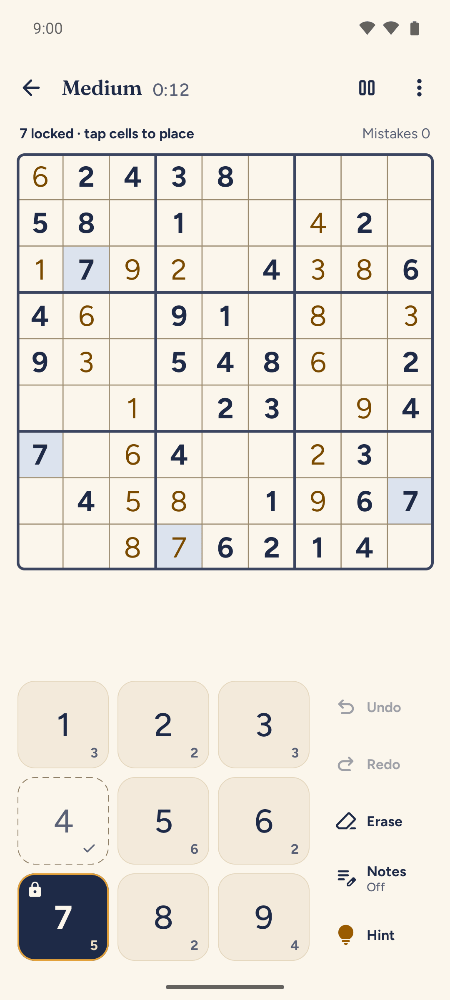
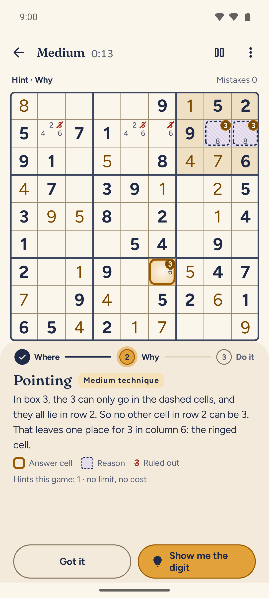
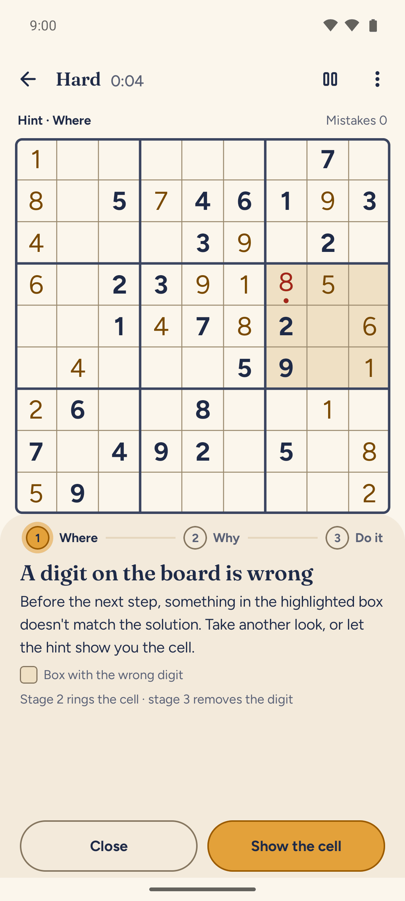
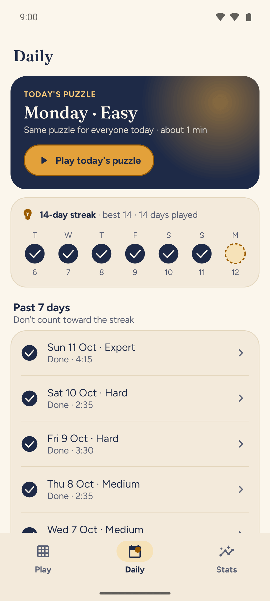
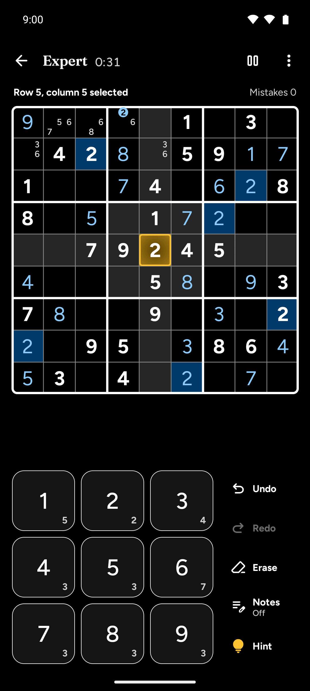
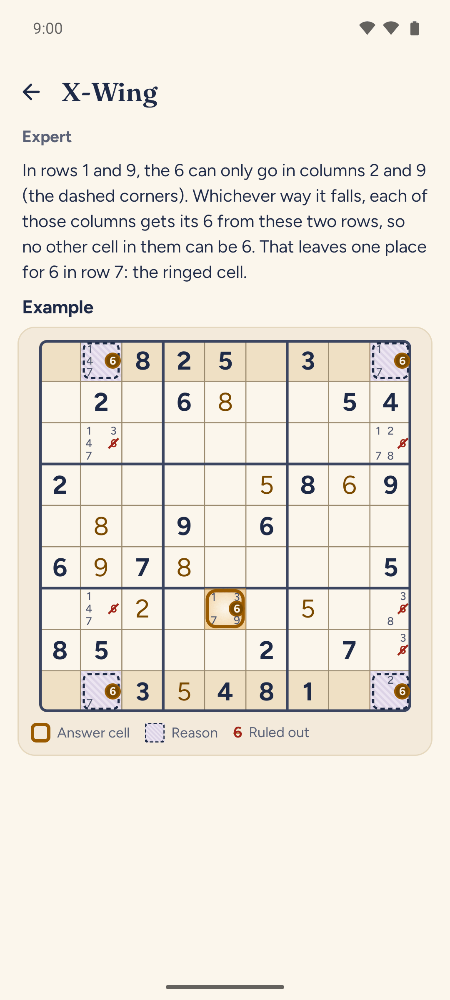

# Lantern Sudoku

**Calm, readable, offline sudoku for Android, with hints that teach.**

No ads, no account, no tracking, no game over, and **no permissions at all**, not even internet access. Free and open source under GPL-3.0-or-later.

<p>
  
  
  
  
  
  
</p>

## What it is

Lantern Sudoku is a quiet sudoku for short, calm sessions.

- **Hints that teach.** A hint lights the next step instead of giving the answer away, in three stages you choose: **Where** to look, **Why** (the technique by name, with the cells that matter highlighted), then **Do it** if you want the digit. If a digit on the board is wrong, the hint says so first, so you never chase a step built on a mistake. Every technique has a Learn page.
- **Honest difficulty.** Four levels, Easy to Expert. Every puzzle has exactly one solution, needs no guessing, and is graded by the hardest technique it needs (from singles up to X-Wing), so a level means the same thing every time. More than 11,000 verified puzzles ship with the app; nothing is downloaded.
- **A daily puzzle** with a gentle streak, past days to catch up on, and a spoiler-free share card.
- **Never punished.** Mistakes can be shown or hidden, a mistake limit is optional and off by default, and the game is saved after every move. Undo, redo, notes that tidy themselves, and statistics per level.
- **Easy on the eyes.** Light, Dark and two high-contrast themes, a Larger digits option, full TalkBack support, and layouts that hold up at 200% system text.

## Install

| Where | Status |
|---|---|
| [GitHub Releases](https://github.com/ukpratik/lantern-sudoku/releases) | Available: signed APK with a SHA-256 checksum. Verify the signer with `apksigner verify --print-certs`; the fingerprint is in [`docs/RELEASING.md`](docs/RELEASING.md#certificate-fingerprints). |
| F-Droid | Coming soon |
| Google Play | Coming soon |

Android 8.0 (API 26) or newer. Each channel has its own signing key, so to switch channels you need to uninstall first.

## Privacy

The app requests **no Android permissions**; CI fails the build if one appears in a release APK. There are no ads, analytics, crash reporting or accounts, and it never connects to the internet. Your games stay on your phone; if Android backup is on, Android may copy them to your own Google account. Full policy: <https://ukpratik.github.io/lantern-sudoku/privacy/>.

## Build, run, test

Requirements: JDK 17 or newer (CI uses 21) and the Android SDK with platform 37. Point Gradle at the SDK with `ANDROID_HOME` or a git-ignored `local.properties` (`sdk.dir=/path/to/Android/sdk`).

```bash
./gradlew assemblePlayDebug          # Google Play flavour (installs as io.github.ukpratik.lanternsudoku.debug)
./gradlew installFdroidDebug         # F-Droid flavour onto a connected device
./gradlew assembleFdroidRelease      # what F-Droid builds (unsigned without signing properties)
./gradlew test                       # unit tests (engine, generator, app on Robolectric)
./gradlew :tools:generator:validateBank          # validate every record of bank/v1 (also part of `check`)
./gradlew :tools:generator:run --args="report"   # grade distribution, hint replay, hand-check sample
scripts/install-hooks.sh             # optional pre-push hook: engine and generator tests, bank validator
scripts/ci.sh                        # every CI gate, exactly as GitHub Actions runs it
```

`scripts/ci.sh` runs the unit tests, the bank validator, Android Lint for both flavours (warnings are errors), R8 release builds of both flavours with the AboutLibraries licence gate, the permission gate (empty allowlist) and the size gate (Play download at most 10 MB).

The two flavours are identical apart from one thing: `play` asks for a Play Store review through Google's In-App Review library, and `fdroid` has a no-op in its place, so the `fdroid` flavour contains no proprietary code.

Startup (needs a device or emulator, API 33+): `./gradlew :app:generateBaselineProfile` regenerates the shipped Baseline Profile, and `./gradlew :baselineprofile:connectedBenchmarkReleaseAndroidTest` measures cold start.

Release builds are unsigned unless signing properties exist in `~/.gradle/gradle.properties`; see [`docs/RELEASING.md`](docs/RELEASING.md). Keys and passwords never go in this repository.

## Project layout

```
engine/              pure Kotlin game engine (no Android): model, solver, techniques, hints, reducer
app/                 Android app (Jetpack Compose, Material 3); flavours play and fdroid
tools/generator/     JVM CLI that generates and validates the committed puzzle bank
bank/v1/             the puzzle bank (11,640 puzzles, plain text) and its manifest; see bank/v1/README.md
design/              design tokens (tokens.css), the source of the app's colour palettes
baselineprofile/     Baseline Profile generator and startup macrobenchmark (device only)
build-logic/         Gradle convention plugins
scripts/             ci.sh, the permission and size gates, subset-fonts.sh
site/                home page and privacy policy (GitHub Pages)
fastlane/            store listing texts, changelogs and images (used by F-Droid)
fdroid/              reference copy of the F-Droid build metadata
docs/                RELEASING.md
```

## Contributing

Bug reports and pull requests are welcome. Please read [`CONTRIBUTING.md`](CONTRIBUTING.md) first; the short version is: no permissions, FOSS dependencies only, tests with the code, and `scripts/ci.sh` green.

## Licence

GNU General Public License v3.0 or later. See [`LICENSE`](LICENSE). Bundled fonts (Fraunces, Figtree) are under the SIL Open Font License 1.1, and the icons are Material Symbols (Apache-2.0).
